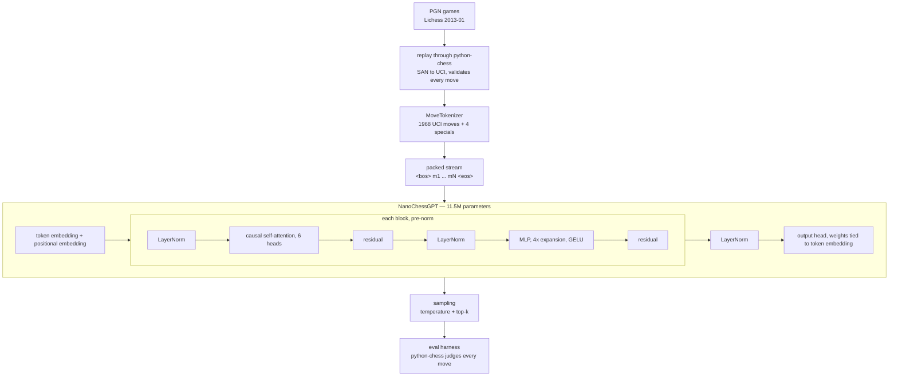

# nanochess

<!-- RESULTS PLACEHOLDER — replaced with real numbers after the training run -->

A decoder-only transformer written from scratch and trained on chess games, to
answer one question with a number instead of a vibe:

> Shown nothing but sequences of moves — no board, no rules, no piece list —
> what fraction of the moves a small language model generates are actually
> **legal** in the position it is generating them for?

Everything from the tokenizer to the sampler is implemented here. The only
things not written by hand are autograd and AdamW.

## Why legal-move rate

Most from-scratch LLM projects report validation loss or perplexity, and a
reader has no way to judge whether 3.1 is good. Chess gives an objective,
externally-verifiable benchmark: python-chess knows the rules, so every
generated move can be checked against the real board state. The model is not
trying to play *well* — it is trying to play *legally*, and that is a fact you
can measure rather than a claim you have to trust.

## Architecture



| | |
| --- | --- |
| Parameters | 11.5M |
| Layers / heads / width | 6 / 6 / 384 |
| Context | 256 tokens |
| Vocabulary | 1972 (1968 UCI moves + `<pad> <bos> <eos> <unk>`) |
| Tokenization | move-level — **one token per ply** |

### Why move-level UCI

One token per move is what makes the headline metric clean. Because a token is
exactly a move, "the model emitted an illegal move" is a well-defined statement
about a single token, checkable with one call into python-chess.

The alternatives were considered and rejected in
[`docs/specs/001-nanochess.md`](docs/specs/001-nanochess.md):

- **Character-level over SAN** — a game becomes ~500 characters instead of ~80
  tokens, so the same board coverage costs 6x the context, and it splits the
  metric into "% well-formed" and "% legal".
- **BPE over SAN** — token boundaries stop aligning with move boundaries, so
  "this token was illegal" stops being meaningful.
- **SAN move-level** — SAN is position-dependent (`Nf3` denotes different moves
  in different positions) and its vocabulary is open-ended. UCI is closed.

A move-level tokenizer is close to a dictionary lookup, which is a fair
criticism. `CharTokenizer` ships alongside it behind the same interface, round-trip
tested, so the abstraction is real and the trade-off is demonstrated rather
than asserted.

## Reproducing

```bash
pip install -e ".[dev]"

python -m nanochess data                  # download + prepare the corpus
python -m nanochess train --preset small  # the real run
python -m nanochess eval                  # the numbers above
python -m nanochess sample --temperature 0.8 --top-k 20
```

`train` is resumable (`--resume`) and takes a wall-clock budget (`--hours`).
Batches are drawn from a generator seeded with `seed + step`, so a resumed run
is bit-identical to an uninterrupted one — there is a test that asserts exactly
that.

## Engineering notes

- **Every tensor op in the model carries a shape assertion.** A from-scratch
  transformer with a broadcasting bug still trains, still shows a falling loss
  curve, and still generates plausible-looking garbage. The assertions turn a
  week of confusion into an immediate failure.
- **The causality test is not a shape test.** It perturbs tokens 5 onward and
  asserts outputs 0–4 are bit-identical. A shape test passes on an attention
  layer that leaks the future.
- **An illegal move does not end the eval walk.** It is recorded, a random
  legal move is substituted, and generation continues. Stopping instead would
  make legal-move rate a restatement of plies-to-first-illegal.
- **Special tokens count against the model.** If it emits `<eos>` when asked
  for a move, that is surfaced as the null move `0000` and scored illegal.
  Re-sampling until a real move appeared would inflate the headline number.
- **Strict TDD.** Every feature landed as a failing test first. The suite runs
  in seconds because no test trains a real model — the smoke tests use a
  2-layer, 16-dimension model.

## Project layout

```
nanochess/
  tokenizer.py   move-level and character-level tokenizers
  data.py        PGN ingest, filtering, packing, batching
  model.py       the transformer, written out
  train.py       training loop, schedule, checkpointing
  sample.py      temperature / top-k / streaming
  evaluate.py    the legality harness
  baselines.py   floor, bar and ceiling
  plot.py        dependency-free SVG training curve
  cli.py         data / train / sample / eval
docs/specs/      the design decisions, written before the code
docs/plans/      the task breakdown
```

## License

MIT.
