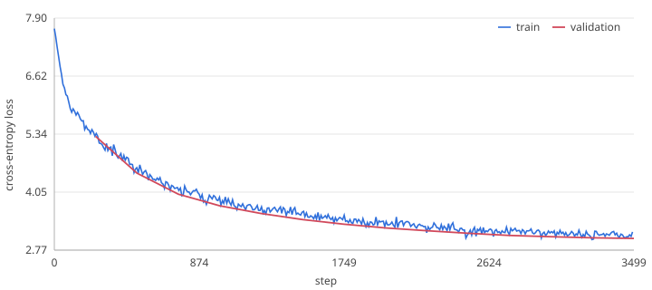
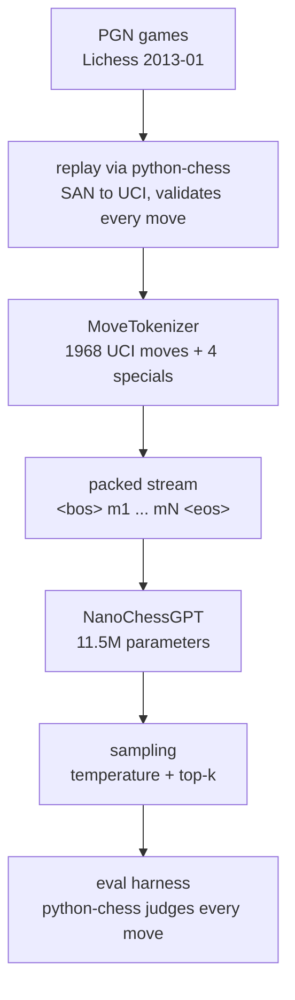
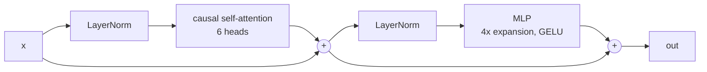

# nanochess --  TRAIN A CHESS ALGORITHM to

mdmnejajjxjdjskkJxjjedjju

**A 11.5M-parameter transformer, trained from scratch on chess games, plays
`97.6%` legal moves over the first 20 plies — having never been shown a board,
a rule, or a piece list.**

| | nanochess | bigram baseline | random tokens | random legal |
| --- | --- | --- | --- | --- |
| **Legal-move rate**, first 20 plies | **97.55%** | 29.85% | 1.5% | 100% |
| **Legal-move rate**, 40 plies | **91.75%** | 20.18% | 1.53% | 100% |
| **Mean plies before first illegal move** | **24.18** | 2.33 | 0.00 | 40 (max) |
| Validation loss | 3.007 | — | — | — |

<sub>100 sampled games × 40 plies, temperature 0.8, top-k 20, seed 0. Every move judged by
python-chess against the real board state. Reproduce with `python -m nanochess eval`.</sub>

Everything from the tokenizer to the sampler is written here by hand. The only
things not implemented in this repo are autograd and AdamW.

## Why legal-move rate

Most from-scratch LLM projects report validation loss, and a reader has no way
to judge whether 3.0 is good. Chess gives an objective, externally verifiable
benchmark: python-chess knows the rules, so every generated move can be checked
against the real board. The model is not trying to play *well* — it is trying
to play *legally*, and that is a fact you can measure rather than a claim you
have to trust.

The model sees only a flat sequence of moves. To emit a legal move on ply 30 it
must have inferred, from the move list alone, where all 32 pieces are, whose
turn it is, what is pinned, and whether it is in check.

## Results

### Legality decays with depth

This is the finding the aggregate number hides:

| Plies | 1–10 | 11–20 | 21–30 | 31–40 |
| --- | --- | --- | --- | --- |
| nanochess | **99.4%** | 95.7% | 90.2% | 81.7% |
| bigram | 41.2% | 18.5% | 11.4% | 9.4% |

The model has effectively memorised opening theory — 99.4% through the first
ten plies — and then degrades steadily as positions leave the well-trodden
paths in the training corpus and the board state it must track drifts further
from anything it has seen.

### Sampling settings matter more than expected

| Sampling | Legal rate (40 plies) | Mean plies to first illegal |
| --- | --- | --- |
| temperature 1.0, no top-k | 82.53% | 18.18 |
| temperature 0.8, top-k 20 | **91.75%** | **24.18** |

Nine points of legality for free. The tail of the distribution is where the
illegal moves live, and truncating it is worth more than a bigger model would
have been at this scale.

### Training curve



3500 steps, batch 24, 256-token context — 21.5M tokens, about 4.4 epochs over
the corpus. Loss 7.10 → 3.06. Train and validation track each other closely,
so at this size the model is capacity-limited rather than data-limited: it is
not memorising the corpus, it simply cannot fit more of it.

### A generated game

Prompted with nothing but `<bos>`, temperature 0.8, top-k 20:

```
1. d4  b6    2. c4  Bb7   3. d5  e6    4. dxe6 dxe6
5. Nc3 Bb4   6. Qc2 Nf6   7. Nf3 Bxc3  8. bxc3 O-O
9. Bg5 h6   10. Bxf6 Qxf6 11. e3  Qxa1?
```

The first 21 plies are legal, and more than legal — that is a coherent Queen's
Indian structure with a real pawn break, a sensible pin, and correct
recaptures. Ply 22 is where it breaks: `f6a1` slides the queen down the long
diagonal **through** its own pawn on c3. The model learned that queens travel
on diagonals; it has not fully learned that pieces block.

## Architecture



Inside the model, per block (pre-norm):



| | |
| --- | --- |
| Parameters | 11.5M |
| Layers / heads / width | 6 / 6 / 384 |
| Context | 256 tokens (≈128 plies — a whole game) |
| Vocabulary | 1972 (1968 UCI moves + `<pad> <bos> <eos> <unk>`) |
| Tokenization | move-level — **one token per ply** |
| Output head | tied to the token embedding |

### Why move-level UCI

One token per move is what makes the headline metric clean. Because a token is
exactly a move, "the model emitted an illegal move" is a well-defined statement
about a single token, checkable with one call into python-chess.

The alternatives were weighed in [`docs/specs/001-nanochess.md`](docs/specs/001-nanochess.md):

- **Character-level over SAN** — a game becomes ~500 characters instead of ~80
  tokens, so equal board coverage costs 6× the context, and it splits the
  metric into "% well-formed" and "% legal".
- **BPE over SAN** — token boundaries stop aligning with move boundaries, so
  "this token was illegal" stops being meaningful.
- **SAN move-level** — SAN is position-dependent (`Nf3` denotes different moves
  in different positions); UCI is closed and position-independent.

A move-level tokenizer is close to a dictionary lookup, which is a fair
criticism. `CharTokenizer` ships beside it behind the same interface,
round-trip tested, so the abstraction is real and the trade-off is demonstrated
rather than asserted.

## What this model cannot do

An honest list, because the number above is narrow.

- **It cannot play good chess.** Legality is not strength. It hangs pieces,
  misses mate in one, and has no notion of winning. Elo was never measured
  because it was never a goal.
- **It does not reliably track blocked lines.** The failure in the sample game
  above is representative: sliding pieces through occupied squares is the most
  common illegal move it produces.
- **It degrades with depth.** 99.4% legal in the opening, 81.7% by ply 40. It
  has not learned chess; it has learned the statistics of chess move sequences,
  and those statistics are far denser in the opening.
- **It has no endgame.** The corpus truncates at 300 plies and the model rarely
  sees decisive endings in a 40-ply window, so behaviour deep into a game is
  essentially untested.
- **It was trained on 67k games from one month of Lichess at Elo ≥1500.** It
  reflects that distribution — club-level blitz openings, not master practice.
- **The numbers come from CPU-only training**, 3500 steps in ~2.8 hours on 4
  cores. The architecture and budget were sized for an Apple Silicon MacBook
  under 4 hours; MPS is substantially faster, so the same budget buys more
  steps and the reported figures should be read as a floor, not a ceiling.
- **`<eos>` mid-game counts as an illegal move.** If the model ends a game
  early when asked for a move, that is scored against it rather than skipped.

## Reproducing

```bash
pip install -e ".[dev]"

python -m nanochess data                        # download + prepare the corpus
python -m nanochess train --preset small \
    --batch-size 24 --lr 6e-4 --max-steps 3500 \
    --dropout 0.1 --hours 3.5                   # the real run
python -m nanochess eval --games 100 --max-plies 40 \
    --temperature 0.8 --top-k 20                # the numbers above
python -m nanochess sample --temperature 0.8 --top-k 20
```

`train` is resumable (`--resume`) and takes a wall-clock budget (`--hours`).
Batches are drawn from a generator seeded with `seed + step`, so a resumed run
is bit-identical to an uninterrupted one — there is a test asserting exactly
that.

## Engineering notes

- **Every tensor op in the model carries a shape assertion.** A from-scratch
  transformer with a broadcasting bug still trains, still shows a falling loss
  curve, and still generates plausible-looking garbage. The assertions turn a
  week of confusion into an immediate failure.
- **The causality test is not a shape test.** It perturbs tokens 5 onward and
  asserts outputs 0–4 are bit-identical. A shape test passes on an attention
  layer that leaks the future.
- **An illegal move does not end the eval walk.** It is recorded, a random legal
  move is substituted, and generation continues. Stopping instead would make
  legal-move rate a restatement of plies-to-first-illegal, and the two headline
  numbers would move together.
- **`random-legal` is a self-check, not just a ceiling.** It must score exactly
  100%. If it ever does not, the bug is in the eval harness rather than the
  model, and a test asserts it.
- **Strict TDD, 182 tests, seconds to run.** No test trains a real model; the
  smoke tests use a 2-layer, 16-dimension config.

## Project layout

```
nanochess/
  tokenizer.py   move-level and character-level tokenizers
  data.py        PGN ingest, filtering, packing, batching
  model.py       the transformer, written out
  train.py       training loop, schedule, checkpointing, resume
  sample.py      temperature / top-k / streaming
  evaluate.py    the legality harness
  baselines.py   floor, bar and ceiling
  plot.py        dependency-free SVG training curve
  cli.py         data / train / sample / eval
docs/specs/      the design decisions, written before the code
docs/plans/      the task breakdown
```

## License

MIT.
